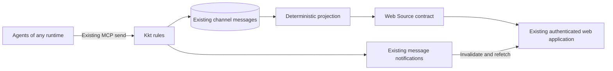

# Channel workboard — #B

Status: the user selected #B inside kkt, a versioned convention, and a
read-only scope. Detailed design proposed for review.
Upstream acceptance remains unconfirmed. This is a design document, not an
implementation or a published maintainer proposal.

## Selected approach

Build **#B: an integrated web view over a documented structured-message
convention**. Agents publish ordinary kkt channel messages; a deterministic
projection turns them into tasks, decisions, approvals, PRs, and issues.
The existing web application displays that projection and refreshes it
without depending on a particular LLM vendor or agent runtime.

Reuse kkt's server, database, web login, channel permissions, authenticated
message authors, and live notifications. Messages remain the durable source
of truth; work items are a view of them. The workboard is read-only: it
displays pending decisions and approvals but does not accept human answers.

The user chose #B to pursue upstream integration. **#A: companion service
and web page** is the fallback if the maintainer declines. Keep the convention
and projection portable without building the companion in parallel.

## Requirements and scope

| Requirement | Design response |
|---|---|
| Queued, active, blocked, and completed tasks | Explicit reports with state, owner, next step, dependencies, and evidence |
| Decisions and approvals awaiting the user | Read-only attention inbox with exact requests, evidence, and source links |
| Associated PRs and issues | Agent-maintained references, facts, and verification timestamps |
| One or multiple channels | Channel-local items and a union of selected channels |
| Agent agnostic and automatically refreshed | Existing message tools, deterministic projection, and live web refresh |

Start with one server and the existing human operator. Bookmarkable URLs
select channels by ID; server-side saved-view records are unnecessary.
Human response forms, operator response messages, task execution, agent
scheduling, forge credentials, PR merging, multi-user roles, task-specific
MCP tools, and a TUI are outside the upstream proposal.

Automatic display refresh follows accepted reports. Semantic freshness
requires agents to report and verify their work. The UI must show stale or
missing reporting rather than claim to know unreported work.

## Approaches and maintainer fit

| Approach | Advantages | Tradeoff and decision |
|---|---|---|
| #B: integrated view over structured messages | One deployment and security boundary; existing tools; rebuildable from history | Maintainer must accept the optional convention and workflow view; selected |
| #A: companion service and web page | Independent release without changing kkt | Additional deployment, data copy, credentials, and authorization; fallback |
| Native workflow entities and MCP tools | Dedicated validation and mutation APIs | Larger storage and public-contract burden; not selected |

`CLAUDE.md` says kkt supplies mechanics rather than prescribed workflows.
#B aims to fit by being opt-in and leaving the chat transport unchanged.
Agents can ignore the convention. This rationale does not establish that
the maintainer will accept it.

The upstream scope is the versioned convention, pure projection, read-only
channel view, live refresh, and multi-channel aggregation. Human response
controls are explicitly deferred, not an implementation increment in this
plan. The user chose integration and a versioned convention; those choices
are no longer open user questions.

Prepare a larger-change issue as the README requests, before substantial
implementation, presenting this chosen scope for maintainer feedback. Ask
about project fit and support burden without assuming acceptance. Any PR
targets `next` and explains existing-install compatibility. Publishing the
proposal requires an explicit instruction; this document prepares it locally.

## Existing project constraints

| Existing behavior | Consequence |
|---|---|
| Stored messages have authenticated authors and increasing IDs | Derive authorship, order, and revisions from messages |
| `send` checks membership, size, rate limits, and secret-shaped content | Reports retain all existing checks; no alternate ingestion endpoint |
| The web operator sees closed and hidden channels | Preserve that access model; hidden boards are read-only |
| `/events` uses transient in-memory notifications | Use it to invalidate views, not as durable state |
| Web reads through `Source`, `web/real.rs`, rules, and store contracts | Add board operations through those boundaries |

The current web page has neither workboard records nor arbitrary human chat
posting. Response forms below are proposed additions.

## User experience

Add a **Work** view to a channel and a top-level work page selecting channels.
Each item shows its home channel and source messages. Conceptual layout:

```text
Work: [#release] [#backend]              Live · checked 8 seconds ago

NEEDS YOU
Approval · Publish release · blocks 2 tasks             [Details]
Decision · Keep old config format?                     [Details]

TASKS
Fix config migration       In progress   agent-a       #backend
Publish release            Blocked       agent-b       #release
Update release notes       Queued        agent-c       #release

PRS AND ISSUES
PR #84 · Changes requested · CI failed                  [Open]
Issue #51 · Open · linked to config migration           [Open]

Coverage: #backend reported recently · #release needs verification
```

Show unanswered requests first, followed by active/blocked tasks, queued
work, and external references. Completed work has a history filter. Sort
requests by explicit priority, number of blocked tasks, then age; the UI
does not ask a model to infer urgency.

Details show the exact subject, requester, evidence, accepted revision,
verification time, and report diagnostics. Show “Read-only: answer through
your existing agent session” and omit answer/approve/reject buttons. Source
links provide context; the existing channel page cannot accept human replies.
Only show an external response link if the requester supplies a safe URL;
otherwise identify the requester and explain that answering happens outside
the workboard.

Preserve scroll, keyboard focus, and open forms during refresh. Use text as
well as color. A channel without valid reports says “No work reported,” not
“No work remaining.” Hidden channels are excluded unless explicitly selected
for read-only history, matching the existing operator experience.

## Architecture and ownership



A small `workboard/` area owns a versioned parser, pure reducer, and result
types. It receives complete message records in order and has no SQL, HTTP,
authentication, LLM, or forge dependency. Rules check access and read history
through the store contract before invoking it. The web uses its own `Source`
types, adapted in `web/real.rs`; the preview provides simulated boards.

Rebuild from complete relevant channel history, not the latest chat page.
Read bounded pages and enforce an explicit rebuild budget. If exceeded,
show “board unavailable: history limit”; never silently omit old work. Choose budgets using representative large-channel fixtures
with the maintainer before implementation is considered ready.

An optional bounded memory cache is disposable. Key it by channel ID and
convention/reducer version, recording the processed message high-watermark.
Catch up from storage before fresh reads. No new durable tables or migration are proposed initially.
If replay costs require a durable index, propose it separately; source
messages must remain sufficient to reconstruct it.

## Structured-message convention

A report body starts exactly with `kkt-workboard/1`, a newline, then a JSON
object. Quoted or embedded markers are ordinary chat. Reject duplicate JSON
keys, invalid types, unsupported operations, and excessive input. Unknown
versions remain readable chat with an unsupported-version diagnostic.

Envelopes contain `request_id`, `item_id`, `op`, and operation-specific
fields. Channel and author come from the stored message, never from JSON.
Item keys are `(channel_id, item_id)`. Creation uses an ID of the form
`<creator-name>/<creator-chosen-id>`; validate the prefix against the stored
author. The first accepted creation fixes the creator and kind.

Operations are `create`, `update`, `verify`, `withdraw`, and `resolve`.
`resolve` records the requester's report that a request was answered elsewhere;
it is not authenticated human authorization. `respond` and `ack` are not
supported in this read-only version and produce diagnostics. An update includes the complete mutable payload and
`base_message_id`, the item's last accepted revision. Creation has no base.
The reducer accepts matching bases in ascending server message-ID order and
uses each accepted message ID as the next revision. The first valid update
wins a conflict; later conflicting messages produce diagnostics.

Only state-changing operations advance that revision. `verify` refers to a
revision without changing it, so a check does not invalidate the next update
base. `resolve` and `withdraw` require the current `base_message_id`.

```text
kkt-workboard/1
{"request_id":"start-migration-1","item_id":"agent-a/config-migration","op":"update","base_message_id":142,"payload":{"state":"in_progress","title":"Fix config migration","owner":"agent-a","next_step":"Verify the previous database schema","evidence_message_ids":[140]}}
```

An accepted `send` means the message was stored, not that its report was
accepted. Preserve the existing tool contract. Agents confirm acceptance
by reading and replaying the relevant channel reports; documentation must
include that procedure and reducer fixtures. On conflict, read later reports
and submit a new request against the accepted revision. No convenience
workboard MCP tool is included in this proposal.

Deduplicate by `(channel_id, stored_author, request_id)`. Identical parsed
content is a no-op retry preserving the original revision; changed content
with the same key is a diagnostic. Invalid reports remain in chat and board
diagnostics, never failing ordinary `send` or disappearing silently.

Historical reports rely on kkt's membership check when they were sent.
Replay does not require a departed author's token or current membership.
Current access determines who can read a board. Changing accepted v1 reducer
semantics requires an explicit compatibility decision so replay stays stable.

## Projected items and permissions

| Kind | Essential fields |
|---|---|
| Task | Title, state (`queued`, `in_progress`, `blocked`, `done`, `cancelled`), owner, next step, dependencies, blocker reason, evidence |
| Decision | Question, options or free-text mode, recommendation, affected tasks, pending/reported-resolved state, optional response venue |
| Approval | Exact action/scope and immutable subject including commit/digest where relevant, optional expiry, affected tasks, optional response venue; no human-authorized outcome |
| PR or issue | Provider-neutral identity/URL, associated tasks, reported status/checks/reviews, observation and verification times |
| Verification | Exact item revision checked, evidence, observing author, server report time |

Any member may report task/reference changes; authorship stays in history.
Only the requester may withdraw, resolve, or replace a pending request.
Request content is immutable: changing its question, options, scope, or
commit creates a new item with `supersedes`, closing the pending old item in
the same reducer operation. A closed request cannot be superseded to erase
its history; a new request can cite it as prior context.

`resolve` requires a nonempty resolution note, evidence description, and
optional channel evidence-message IDs or a safe external evidence URL. Show
“Reported resolved by <agent>,” not “You approved.” Expiry is evaluated from
server time for pending requests and does not create an approval. Historical
resolution validity uses the report's stored server creation time.

Verification references the exact substantive revision without changing it.
An agent-reported external answer does not start a task, a merged PR does
not complete a task, and silence is not progress. Reopening a task requires
a reason; `blocked` needs a stated blocker.

All v1 relationships are channel-local, simplifying replay and avoiding
private cross-channel title/count leaks. The aggregate page unions selected
channels without merging their items. The same PR can appear in several
channels: group by canonical external identity for display while retaining
each association's channel context. Cross-channel dependencies, multi-home
items, and moving items are deferred.

## Read-only boundary and request resolution

The user answers through an existing agent session or another established
venue outside the workboard. This design does not invent that venue or
require the existing kkt web page to support human chat. Requests can
identify an optional response URL and the requesting agent.

Agents keep the display updated by reporting external resolution through
`resolve`, with evidence and exact request revision. Such reports are
agent-authored claims, not authenticated human answers. Never use them as
permission to execute an action, bypass runtime controls, or manufacture
operator messages. No approval-verification mechanism is shipped here.

The workboard adds only GET routes and reads through the existing web
contract. It has no response forms, POST route, mutation rule, answer schema,
operator writer, response IDs, or acknowledgment protocol. Existing web
administration capabilities are unaffected. Human responses would require a
separate design and explicit scope decision later, including the fact that
current admin notices can also have stored author `operator`.

## Automatic refresh and recovery

Subscribe to existing authenticated events before fetching a board snapshot.
Buffer invalidations during the fetch; then refetch channels whose message
IDs exceed the snapshot high-watermarks. Events invalidate views but are
never the only copy of work state.

Reload selected channel projections after reconnect, page focus return, or
detected notification loss. A periodic reconciliation fetch (proposed:
every 30 seconds while visible) recovers notifications lost between commit
and publish. Coalesce bursts and prevent old fetch responses from replacing
newer channel high-watermarks. Reconcile hidden-channel state as well.

An accepted report should appear within 2 seconds on a healthy local
connection. Distinguish transport health from semantic verification. Proposed
staleness thresholds are 15 minutes for active work and 2 minutes for external
facts, with explicit settings or constants in `config.rs`. Agent-supplied
future observation times must not suppress stale indicators.

Agents report when accepting, starting, blocking, requesting input, linking
external work, handing off, and finishing. Verification identifies the
revision/evidence checked. Ordinary prose is context, not authoritative
state; a steward agent can read it and publish explicit reports.

The board does not run or wake agents. Periodic verification requires an
agent assigned through the deployment's existing runtime/scheduler. Show
“automatic verification not configured” unless an agent explicitly reports
responsibility and cadence; show overdue verification when reports stop.
Kkt must not gain an LLM invocation loop to maintain this page.

## PR and issue updates

Agents attach references and refresh facts through their existing forge tools.
A designated agent can periodically check active links and publish reports
without forge credentials or provider adapters in kkt. Suggested cadence is
60 seconds for active work and 15 minutes for terminal references, respecting
provider limits. These are agent instructions, not server scheduling guarantees.

On failure, preserve last successful facts and report the failed check.
Label facts as agent reported and show verification time; keep external
status separate from conclusions about task completion. Unsupported forges
remain useful through links and the same provider-neutral fields.

Do not fetch arbitrary URLs from the server. Render agent text escaped and
allow safe link schemes only. Built-in provider adapters and webhooks need
a separate proposal. Deployment documentation must plainly state that
periodically refreshed external facts require a running reporting agent.

## Security and compatibility

#B adds no listener, credentials, watcher identity, agent-token proxy, or
second store. Preserve existing web/MCP key separation, session policy,
Host/Origin checks, and channel access. The work page is an operator view,
not an agent-facing endpoint exposing private channels.

New risks still need review: parser resource exhaustion, script injection,
misleading requests, and reports mistaken for human authorization. Bound
parsing/replay, escape content, show authors and exact subjects, and test
that no report or stored author creates an authenticated approval state. Selecting
channels filters a view; it is not a new security boundary.

Hidden channels are read-only for explicit human inspection and remain
`not_found` to agents. Existing tools, errors, login behavior, and ordinary
chat retain their meaning. Old histories need no conversion. A server
without workboard support displays reports as text; downgrading removes
the view but retains source reports. Existing backups
retain all source state.

Keep SQL in `store/sqlite.rs`, authorization in rules, time in injected
`Clock`, and settings in `config.rs`. Update web preview data and relevant
script tests with the UI. Convention instructions are opt-in reference
material, not a mandatory workflow in every agent's base instructions.

## Delivery and acceptance

1. **Upstream scope:** prepare the maintainer proposal for the chosen
   integrated, versioned, read-only scope before substantial work.
2. **Convention/projection:** document exact envelopes and reducer fixtures
   covering retries, conflicts, malformed reports, external resolution, and
   historical authors. Two agent runtimes report without vendor coupling.
3. **Channel view:** add the read-only work page through `Source` and rules,
   with full-history replay, diagnostics, freshness, preview, and live recovery.
4. **Aggregation/adoption:** add channel-selection URLs, document external
   response venues and verification responsibilities, and exercise large
   channels. Reconsider #A only if needed.

Verify full versus incremental replay; conflicting bases/request IDs;
departed authors; unsupported response envelopes; requester-only external
resolution and its evidence; hidden channels; expiry; cache invalidation;
event/snapshot races; missed notifications; excessive histories; escaped
markup; future observation timestamps; and existing-install compatibility.
Assert workboard routes are read-only and no approval state is described as
human-authenticated. An implementation must pass required Rust and relevant
web checks before a commit or PR.

## Remaining decisions

The user settled #B inside kkt, a versioned convention, and read-only scope.
#A remains the fallback. Maintainer acceptance is unconfirmed. Implementation
planning pins schemas, reducer transitions, budgets, routes, settings, and
fixtures. Human response support is deferred and is not part of the current
implementation plan.
